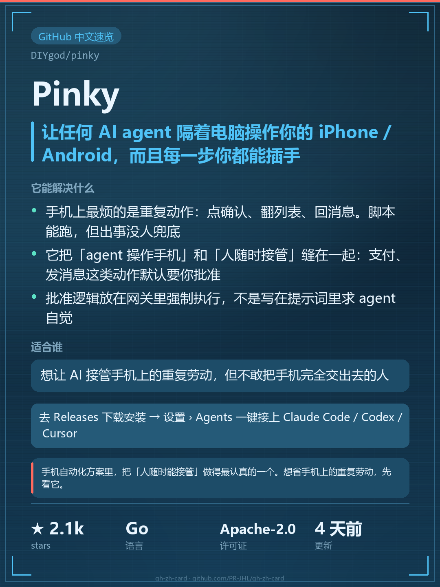
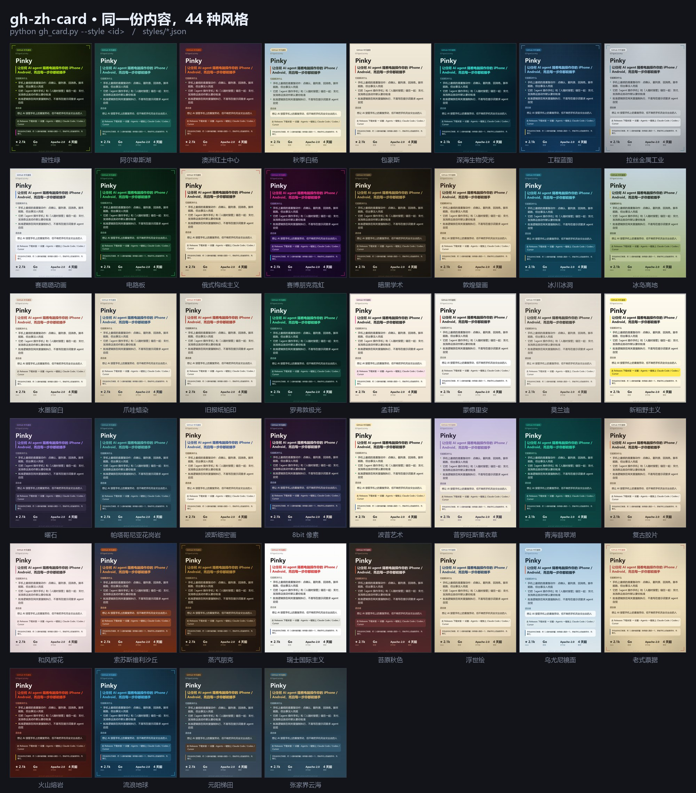
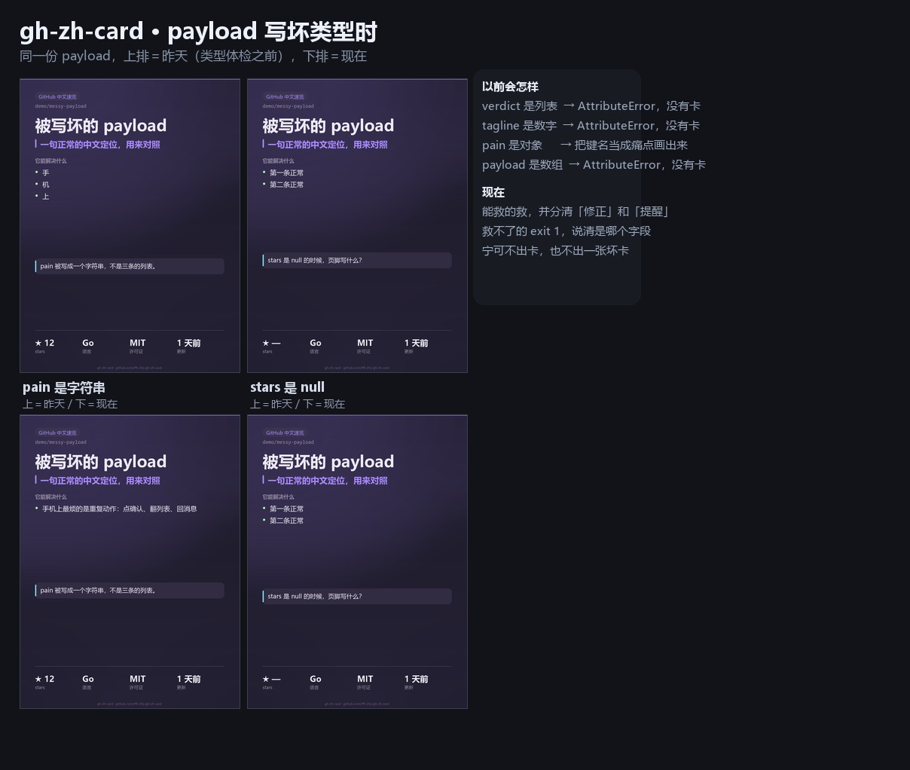
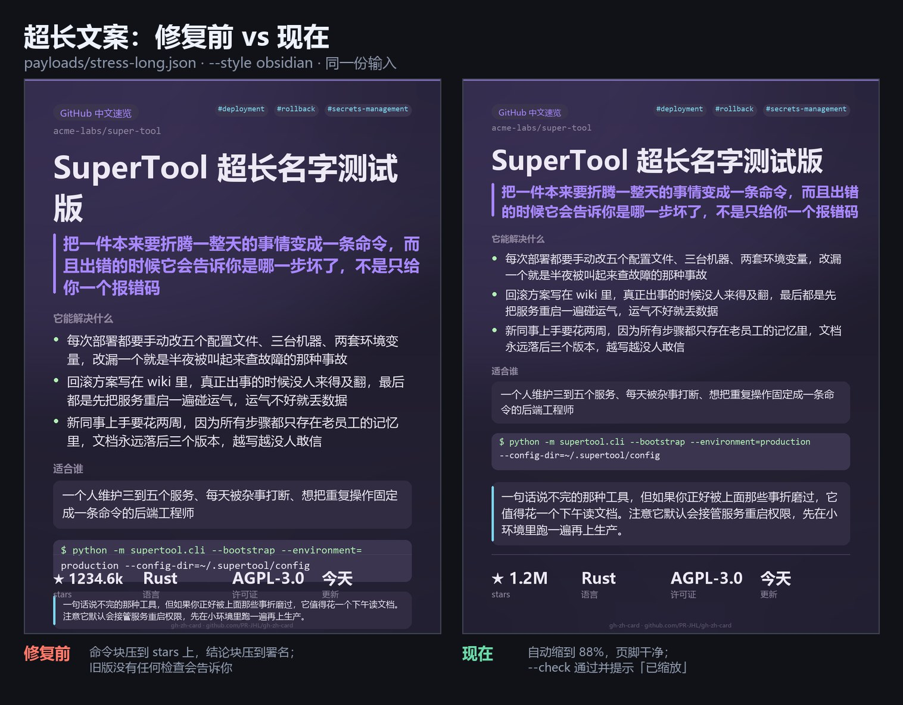
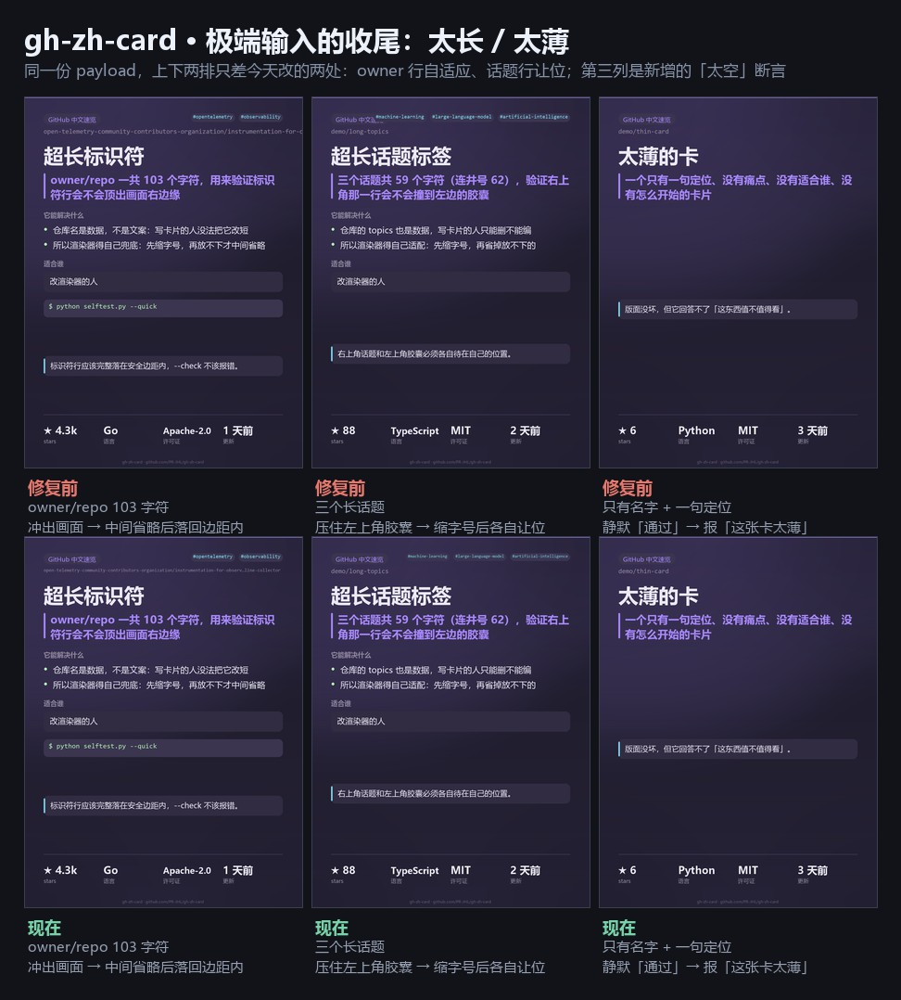
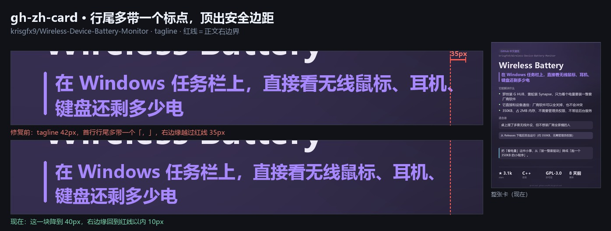

<div align="center">

# gh-zh-card

**30 秒看懂一个 GitHub 项目 —— 一张中文卡片，替你读完 README**

简体中文 · [English](#english)


</div>

## 问题

GitHub 热榜每天几十个项目。点进去：英文 README 三千字，翻到底才发现——**这个我用不上。**

`gh-zh-card` 把它压成一张图：它到底让你能做到什么、解决哪个具体的痛、适不适合你、怎么开始、数字是不是真的。

<p align="center">
  
  &nbsp;
  
</p>

<p align="center"><sub>同一份内容，两种风格：<code>--style obsidian</code> / <code>--style wandering-earth</code></sub></p>

卡上的数字全部来自 GitHub API，不是手填的。

## 它是什么

一个 **agent skill**（Claude Code / Codex / Cursor / DSH 都能用）+ 一个零额外依赖的渲染脚本：

- `gh_card.py` 只做两件硬事：**从 GitHub API 取真数据**、**把排版渲染成 1080×1440 PNG**
- 中文文案由 **agent 写**（它读过 README），不是机器翻译 —— 这是它和「翻译插件」的根本区别
- 数字不接受手填：`--fetch` 直接打 API；`--offline` 模式要求你写已核实的数字

## 安装

```bash
git clone https://github.com/PR-JHL/gh-zh-card
cd gh-zh-card
pip install pillow requests   # 大多数 Python 环境已经有
```

装成 skill：把整个目录放进你的 agent 的 skills 目录，或直接让 agent 读 `SKILL.md`。

## 用法

**给 agent 用（推荐）** —— 把 `SKILL.md` 交给它，然后说：

> 帮我看下 DIYgod/pinky 这个项目，做一张中文速览卡

**自己用手** —— 抓数据 + 渲染：

```bash
# 一条命令出卡（推荐）：文案体检 -> 渲染 -> 版面自检 -> 落一份卡片档案
python card_build.py payloads/pinky.json --style obsidian

# 或者拆开一步步来（调试、或者只想出图不做体检时）
python gh_card.py --fetch DIYgod/pinky --payload payloads/pinky.json --out out/ --name pinky
python gh_card.py --payload payloads/pinky.json --offline --out examples/ --name 01-pinky --md --caption
```

`card_build.py` 是**闸门**，不是又一个渲染器：它按顺序调用 `copy_check` → `gh_card` → `card_check`，
任何一步报错都不给「可以发」，退出码 1。顺序是有意的 —— **文案体检不过时连图都不生成**，
否则总会有人顺手把那张图发出去。

每张卡旁边还会落一份 `<name>.card.json`：

```json
{"style": {"id": "obsidian"}, "canvas": [1080, 1440],
 "stats": {"stars": 2059, "fetched_at": "2026-11-18T09:00:00Z"},
 "stats_provenance": "fetched",
 "files": {"png": {"sha256": "…", "bytes": 232802}},
 "publishable": true, "reason": "可以发"}
```

它记下**这张卡的数字是什么时候的**、用的哪套风格、三个文件的 sha256。以前这些只在 payload 里，
而后来的 26 份真实 payload 里一份 `stats_fetched_at` 都没有 —— 也就是说「这张卡上的星数现在还对不对」
这件事，事后谁都回答不了。

`--fetch` 会用 API 的真数据覆盖 payload 里的旧统计（文案字段不动）。再加 `--save`，数字和抓取时间
会被写回 payload —— 之后 `copy_check.py` 才能离线复核，卡片也永远能回答「发布时星数是多少」。

三条产出：

| 文件 | 用途 |
|---|---|
| `*.png` | 1080×1440 卡片，小红书 3:4 / 公众号 / X 长图通用 |
| `*.md` | Markdown 版，做 issue、公众号正文 |
| `*.caption.txt` | 自媒体文案 + hashtag |

## 风格

卡片外观完全由 `styles/<id>.json` 决定，改配色不用碰代码：

```bash
python gh_card.py --payload payloads/pinky.json --offline --out examples/ --style wandering-earth
python gh_card.py --payload payloads/pinky.json --offline --out examples/ --style obsidian
```

**自带 44 套风格**（28 套纸感印刷 + 16 套风光片）：



| 家族 | 套数 | 色彩从哪里来 | 适合 |
|---|---|---|---|
| `gen1-print` 第一代 · 纸感印刷 | 28 | 油墨、纸张、矿物颜料 | 印刷物、复古、严肃文档、文化题材 |
| `landscape-photo` 风光片 | 16 | 自然光、大气散射、水面反射 | 自然/旅行/摄影/需要"呼吸感"的封面 |

```bash
python gh_card.py --list-styles                    # 看全部 44 套
python gh_card.py ... --style lofoten-aurora       # 罗弗敦极光（墨绿夜空 + 极光弧）
python gh_card.py ... --style sossusvlei-dune      # 纳米布沙丘（铁锈红 + 钴蓝）
python gh_card.py ... --style swiss-international  # 瑞士国际主义（最稳的一套）
```

风光片家族的规则是「**竖向渐变就是画面本身**」：`bg_top` 是天空上沿，`bg_bottom` 是地平线或水面。所以它们不是"换了颜色的纸"，是另一种东西。

一个风格 JSON 只需要三块：`palette`（12 个颜色）、`decor`（网格/扫描线/四角标/外框/顶部色带/柔光/压暗）、`type`（标题倍率、行高、等宽开关）。

**想加自己的风格**：复制一个 JSON 改颜色即可；或者用 `--style-dir <目录>` 加载外部风格库。

设计约束只有两条：**不许纯黑死卡**（深色必须有柔光或明显渐变，否则就是"没希望的黑"），**不许 AI 默认审美**（判据：这个配色放到任何 AI 生成的落地页上都毫无违和，那它就是废的）。

重新生成总览图：`python gallery.py`

## 自检：一只管文案，一只管版面

这个工具只有两个地方会「说谎」：**文案说错**，和**版面排坏**。两只手各管一头。
（出卡时可以用一条命令把两头和一纸档案串起来：`python card_build.py p.json --style obsidian`
—— 文案体检 → 渲染 → 版面自检 → `<name>.card.json`，任何一步不过都不会说「可以发」。）

### 文案体检（渲染前）

```bash
python copy_check.py payloads/pinky.json           # 离线：文案 vs payload
python copy_check.py daily/2026-11-19/ --online    # 在线：顺便抓实时数据核对
```

| 类别 | 检查什么 |
|---|---|
| 数字 | 文案里的星数、推送天数、许可证，跟 payload（或实时 API）对不对得上 |
| 时效 | 数字是什么时候抓的（`--max-age`）—— 涨得快的仓库，星数一上午就能差 30% |
| 结构 | 缺字段、`start` 带 `$`、tagline 没中文、痛点写成「支持截图/支持点击」这种功能清单 |
| 夸大 | 「最强 / 史上最 / 颠覆 / 绝对」这类当场能被证伪的词 |
| 长度 | 超预算时直接算后果：这张卡会缩到多少字号、结论会不会被截断 |

它不判断「文案有没有说到点上」——那要读 README，机器做不了。

### 形状体检（渲染前，自动）

payload 是 agent 写的 JSON，最常见的错不是「文案不好」，而是**类型写错**：`"pain": "一整段话"`、
`"verdict": ["两句"]`、`"stars": null`。这三种以前分别会：把字符串按字符拆成三条只有单字的痛点
（「手」「机」「上」）、`AttributeError` 崩掉、页脚写「★ None」。

现在进渲染之前先过一遍类型体检：能救的就地救（并且分清「修正」和「提醒」），救不了的 exit 1 并
说清是哪个字段，**宁可不出卡，也不出一张坏卡**。

<p align="center">
  
</p>
<p align="center"><sub>同一份 payload：上＝类型体检之前（单字痛点、页脚「None」），下＝现在</sub></p>

| 写错的形状 | 现在的处理 |
|---|---|
| `pain` 是一整段话 | 按换行 / 分号 / 竖线拆成条目（**不按句号拆** —— 一句话本来就有句号） |
| `verdict` / `tagline` 是列表或数字 | 列表用「，」接成一句；数字转成文本 |
| `topics` 是一行逗号分隔的字符串 | 拆成多个标签 |
| `stars` 是 `null` 或写不成整数 | 页脚写「—」。不知道就写不知道，不写 0 |
| `pain` 是对象、`payload` 是数组 | 拦住，exit 1，说明哪个字段错在哪 |
| 字段名拼错（比如 `tag_line`） | 提醒是不是 `tagline`，并忽略这个字段 |

### 版面自检（渲染后）

好卡片和「压坏了的卡片」差别很小，但压坏的那张读者一眼就能看出不专业。所以渲染是
**先排版、再落笔**：内容塞不下时先整体缩字号，再省次要区块，绝不会静默压到页脚数据条上。

<p align="center">
  
</p>
<p align="center"><sub>同一份超长文案：左＝修复前（命令块压到 stars 上，结论块压到署名），右＝现在（自动缩到 88%，版面干净）</sub></p>

```bash
python gh_card.py --payload payloads/pinky.json --offline --out out/ --check
```

`--check` 断言的是这些事：

| 类别 | 检查什么 |
|---|---|
| 版面 | 文字出界、压页脚数据条、两块文字互相压住、单行超宽 |
| 文案 | 为了塞进版面被省略 / 被截断的字段 —— 该改文案，不是改排版 |
| 信息量 | 版面干净、但正文只占了不到 55% 的竖向空间 —— 报「太空」，并列出缺哪几块 |
| 数据行 | `owner/repo`、话题太长时的自动适配（缩字号 / 中间省略 / 省掉），是提示不是错误 |
| 可读性 | 对比度、字号被缩得太小、豆腐块（缺字形）、深色卡发闷 |

<p align="center">
  
</p>
<p align="center"><sub>同一份 payload：上＝修复前（标识符冲出画面、长话题压住左上角胶囊、太空卡被静默放行），下＝现在</sub></p>

还有一类更安静的出界：**行尾禁则**。为了不让标点出现在行首，换行时会允许行尾多带一个标点 ——
那一行就比排版宽度宽一点。多数块离安全边距还有余量，看不出来；但 tagline 的可用宽度正好顶到
安全边距，多一个字就真的出去了：

<p align="center">
  
</p>
<p align="center"><sub>krisgfx9/Wireless-Device-Battery-Monitor：首行行尾多带一个「，」，右边缘越过安全边距 35px；现在这一块会自动降一档字号</sub></p>

判据不是「比排版宽度宽」（那本是禁则的余地），而是「比这块文字真正能占的宽度还宽」——
所以自动缩字号只在真的会出界时发生：44 套风格 × 9 份样本逐张比 sha256，**396/396 完全一致**。

极端输入也有兜底，因为**有些东西根本不归写文案的人管**：
- **`owner/repo` 是数据，不是文案。** 超过一行宽就缩字号，缩到底还放不下才中间省略
  （保留 owner 开头和 repo 结尾）；它不会在 `--check` 里报「必须修」——那等于让人回去改上游仓库。
- **话题会自己让位。** 三个长话题放不下时先缩字号，再省掉末尾几个，绝不压到左上角的胶囊上。
- **太薄的卡会被指出来。** `THIN_CARD`：正文只占版面高度不到 55% 时提醒「这张卡替代不了
  README」，并直接列出缺哪几块。版面干净不等于卡能用。

改风格、改排版之后跑一遍回归：

```bash
python selftest.py            # 44 套风格 × 8 份 payload，逐张自检（约 3 分钟）
python selftest.py --quick    # 6 套代表风格，十来秒
python copy_check.py --selftest   # 体检工具自己的用例（好文案要放行、坏文案要被抓到）
```

`selftest.py` 里有两道「自检本身有没有坏」的护栏：缺字形样本必须被抓到豆腐块，
只有名字和一句定位的样本必须被报出 `THIN_CARD` —— 报不出来就算失败。

`--sheet docs/long-copy.jpg` 还能拼一张「同一份超长文案在 8 套风格下的样子」，改排版前后对比很直观。

## payload 字段

| 字段 | 必填 | 说明 |
|---|---|---|
| `owner` / `repo` / `url` | ✓ | 仓库标识 |
| `name_zh` | ✓ | 项目名，保留原名即可 |
| `tagline` | ✓ | ≤34 汉字，说清它让你能做到什么 |
| `pain` | | 3 条，≤38 字/条，写具体的痛 |
| `for_who` | | ≤30 字，写给一类人 |
| `start` | | 怎么开始；是命令就不带 `$` |
| `verdict` | | ≤50 字，一句话结论 |
| `stars` / `language` / `license` / `updated` | | `--fetch` 自动填；`--offline` 时须已核实 |
| `topics` | | 最多 3 个，用仓库真实 topics |

## 署名

生成的卡片底部有一行很淡的

```
gh-zh-card · github.com/PR-JHL/gh-zh-card
```

这是这个工具唯一的传播方式——**卡片被转发时，链接跟着走**。不想要就加 `--no-credit`。

## 想让自己的项目被做成卡片？

开一个 [issue](https://github.com/PR-JHL/gh-zh-card/issues/new?template=card-request.yml)，模板会问三件事：仓库地址、为什么值得被看到、想突出的点。

**不用是作者本人**——你在用的项目也可以提。

## 设计原则

1. **数字必须真。** 卡片上唯一能被一眼验证的就是 stars 和 license，编一次就没人信了。
2. **宁可不说，不要硬吹。** `verdict` 里不出现「最强 / 第一 / 颠覆」。
3. **一张图要能替代点进 README。** 看完还不知道自己该不该用它，就是没做好。

## 局限

- 不判断代码质量 —— 没跑过测试就不替项目背书
- 不做技术翻译 —— 回答「该不该看」，不是「原文说了什么」
- 文案超长时会自动缩字号、省略次要区块，并让 `--check` 报错 —— 但内容该删还得删，
  脚本能保住版面，保不住「一张图说清一件事」
- 反过来，文案太薄时 `--check` 只能提醒（`THIN_CARD`），补内容这件事机器替不了
- `owner/repo` 或话题特别长时，卡上会被缩字号或中间省略 —— 那是仓库数据，脚本改不了它
- 需要本地中文字体：Windows 微软雅黑 / macOS 苹方 / Linux Noto CJK
- 排版只支持中文 + 英文混排；纯日文/韩文可能缺字形（`--check` 会报出豆腐块）

## English

`gh-zh-card` turns any GitHub repo into a 1080×1440 Chinese quick-look card plus a ready-to-post caption.

The Python script does the two things that must not be fudged: it pulls real stats from the GitHub API, and it renders the layout. The Chinese copy is written by your coding agent **after it reads the README** — that is the difference between this and a translation plugin. It answers one question: *should I spend time on this repo?*

```bash
python gh_card.py --payload payloads/pinky.json --offline --out examples/ --name pinky --md --caption
```

Requires Python 3.9+, Pillow, requests, and a local CJK font (Microsoft YaHei / PingFang / Noto CJK).

## License

MIT